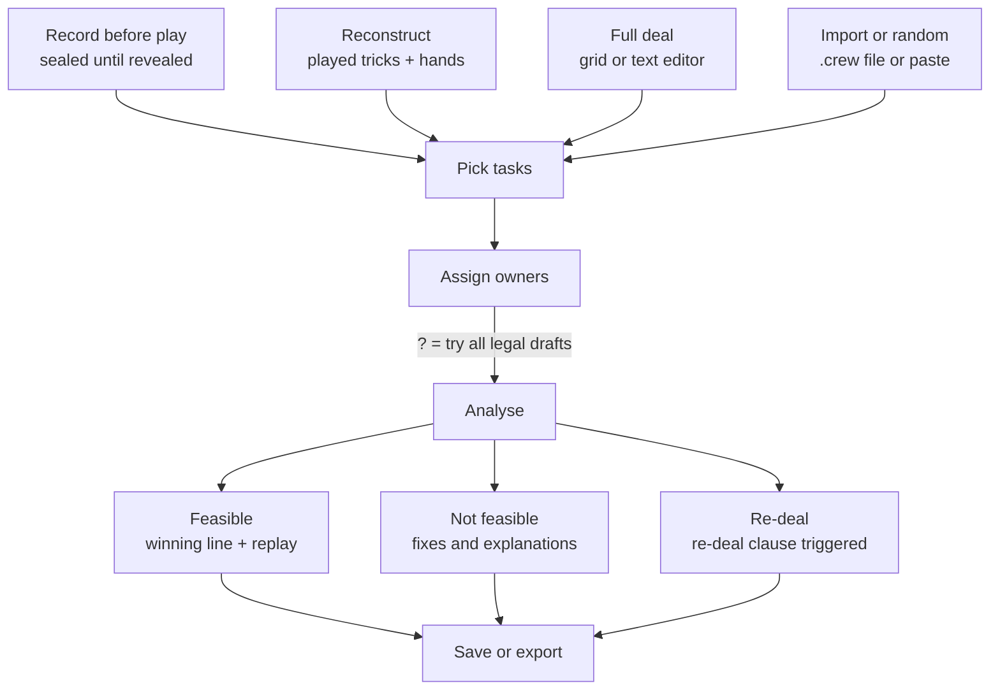

# Deep Sea Solver – Design Spec

Exported 2026-10-24 from the living design doc (Claude Docs). Mockups: the
[mockup canvas](https://claude.ai/artifact/7ELMZaWW11WFLNeC3pVPG8).

## Purpose and scope

The tool answers two questions about a deal of *The Crew: Mission Deep Sea*: could the tasks have been fulfilled with perfect play, and how hard was it. It assumes perfect information: all hands are known.

- **Users:** Q and his game group. No public release, minimal polish.
- **Use moments:** post-mortem at the table on a phone ("was it even possible?"), and exploration at a desk (random deals, task statistics).
- **Not a use moment:** a spoiler-free check before play. That would need private per-player entry synced through a server.
- **Edition:** Mission Deep Sea only, 3 to 5 players. Planet Nine, the 2-player variant and logbook special rules are out of scope for v1.

## Decisions log

All decisions below were taken by Q during the design phase on 2026-10-23 and 2026-10-24.

| # | Topic | Decision | Rationale |
| --- | --- | --- | --- |
| D1 | Edition | Mission Deep Sea only | Focus; Planet Nine has a different task system |
| D2 | Player counts | 3, 4 and 5 players | 2-player dummy variant adds rules for little value |
| D3 | Task input | Tasks may be pre-assigned, or left unknown and searched over all legal drafts | Post-mortem knows the draft; exploration does not |
| D4 | Distress signal | Ignored entirely | Keeps the search space small |
| D5 | Difficulty | Measures defined in Solver behaviour | Settled by Q1–Q3 |
| D6 | Language of the solver | Rust | Speed; compiles to WebAssembly |
| D7 | Platform | Installable web app (PWA), solver runs in the browser via WebAssembly; a CLI from the same crate | Works on phone and desktop, offline, no server |
| D8 | Card input | Tap grid first; text notation and file upload too; photo recognition later | Grid is fastest on a phone; text suits desktop and files |
| D9 | Audience | Q and his game group | Private hosting is enough |
| D10 | Entry flows | Both "record hands before play" and "reconstruct a failed mission" | Hands are gone after play; early fails keep most cards in hand |
| D11 | Failure analyses | Smallest conflicting task set and point of no return are in scope | Explains *why* a mission failed |
| D12 | Player naming | `Player1` to `Player5`, explicit, no custom names | Avoids clash with card `P1` (pink 1) |
| D13 | Look | Dark "deep sea" style as mocked up | Accepted as is |
| D14 | Languages | UI in German and English; code, files and notation in English only | German is a display concern |
| D15 | Import / export | Every situation can be saved, exported and imported, including sealed hands | Backup, moving between devices; no cheating expected |
| D16 | Submarines and numbers | Submarines do not count as numbers or in sum tasks | Confirmed by Q on 2026-10-24 |
| D17 | Generalized tasks | Every task of the official categories as a parametric ID; inferred difficulty (rule of thumb, ≈) now, measured later; rule cards not generated; random draws and the default list use official cards only; official cards get marked once Q supplies the 96 | Decided by Q on 2026-10-24 |

The interview decisions (Q1–Q12 and follow-ups) are in the resolved questions table at the end, with options and reasoning.

## Platform and architecture

One Rust core crate does all game logic; a CLI and a WebAssembly build wrap it, and a static web app runs the WebAssembly build in a background worker. There is no server.

| Component | Role |
| --- | --- |
| `crew-core` (Rust library) | Card and deck model, rules engine, task catalogue, solver, draft search, analyses, text notation parser and writer |
| `crew-cli` (Rust binary) | Solve a file, batch random deals, benchmarks, differential tests |
| `crew-wasm` (Rust → WebAssembly) | Thin bindings for the browser; progress callbacks and cancellation |
| Web app (PWA) | Screens, i18n, local storage, import and export; runs `crew-wasm` in a Web Worker so the UI never freezes |

- **Offline:** a service worker caches the app; everything works without network after the first visit.
- **Hosting:** GitHub Pages, built and deployed by GitHub Actions from the GitHub repository.
- **Performance budget:** verdicts are always exact, however long they take, with progress and cancel. Only the count of working drafts is sampled on large cases ("about 30% of drafts work, 2,000 sampled"), with an option to count exactly.

**UI:** Svelte with TypeScript.

**Bot-ready:** the hidden-hand bot comes after v1, but v1 prepares for it. The solver accepts sampled hands for players whose cards are unknown, and communication (one token per player: highest, only or lowest card of a colour) is its own module. The bot then adds code without changing the core.

## Game model

The solver implements the core trick-taking rules of Mission Deep Sea exactly; communication never changes which plays are legal, so it is not modelled for feasibility.

**Deck and deal**

- 40 cards: pink (P), blue (B), green (G), yellow (Y) with values 1 to 9, and submarines (S) 1 to 4 as trumps.
- All cards are dealt. 3 players: 14/13/13 over 13 tricks, one card is never played and its holder chooses which. 4 players: 10 each. 5 players: 8 each.
- The holder of S4 is captain: picks the first task and leads trick 1.

**Trick play**

- Clockwise. Follow the led suit if you can, trumps included. Off-suit you may play anything.
- Highest submarine wins; otherwise the highest card of the led colour. The winner leads next.

**Tasks**

- A task is *done* when it can no longer fail; the mission fails as soon as any task becomes impossible.
- Each task evaluates after every trick to done, failed or open. Leading constraints ("don't open with pink") are checked when a trick is led.
- "Exactly", "none" and "more than" tasks settle only at the end; they keep running bounds so the solver can fail them early.
- Prediction tasks are always met under perfect information (the player predicts the count of the winning line).
- Submarine tasks with a re-deal clause yield the verdict **Re-deal** when the clause triggers.
- Submarines do not count as numbers ("no 1s", "win with a 2") and not in sum tasks.

**Rule cards** are a new category made from the logbook's play rules, for example "no trick may be led with pink or a submarine". They apply to the whole crew, carry no difficulty value and are evaluated like tasks: done, failed or open after every trick.

**Draft rules (for the draft search)**

- Captain picks first, then clockwise. With n tasks and p players the first n mod p seats from the captain take one more task.
- With fewer tasks than players, each player takes at most one task.
- The captain may not take the three "compared with the captain" tasks.

Logbook draft modes are selectable: standard, free distribution, all tasks to one player, captain gets no task, captain takes the hardest task first.

## Task catalogue

All 96 task cards are data, not code: one record per card with a stable English ID, a category, parameters, the difficulty for 3/4/5 players and the display text in English and German.

| Category | Cards | Example | Engine check |
| --- | --- | --- | --- |
| Win specific cards | 16 | Win B4 | Each named card ends in the owner's tricks |
| Win none of | 11 | Win no pink | Settles at the end; fails at the first card won |
| Colour counts | 10 | Win exactly 2 blue | Running count with upper and lower bounds |
| Trick with a property | 12 | Trick of only odd cards | Checked on each trick the owner wins |
| Win a trick using a value | 7 | Win a 5 using a 7 | The winning card of the trick |
| Win specific tricks | 7 | Win the first trick | Fixed trick indices |
| Number of tricks | 5 | Win exactly 2 tricks | Trick count bounds; prediction always met |
| Value counts | 5 | Win at least two 7s | Running count |
| Consecutive tricks | 5 | Win 3 tricks in a row | Current and best streak |
| Don't win certain tricks | 4 | None of the first 3 | Fixed trick indices |
| Compared with the captain | 3 | More tricks than the captain | Captain may not take it |
| Never lead with | 2 | Don't open with pink or green | Checked when the owner leads |
| Other | 9 | All cards of one colour | Mixed |

**Rule cards** form an extra category beside the 13 above: one card per logbook play rule, picked manually in the task picker, owned by the crew, without difficulty value.

**Task IDs** are short and readable because they appear in files: `win B4`, `win P9 Y8`, `no pink`, `first-trick`, `tricks =2`.

**Data source:** Q's photos of the German edition give the verbatim German texts, parameters and difficulty values. English texts follow the fan translation unless official English wording turns up. Until the photos are transcribed, the fan-made BoardGameGeek list (also used by remigerme/the-crew-solver) stands in, with known doubts:

- "Win the pink 1" or "pink 3": the list and that solver's code disagree.
- "None of the first 3 tricks": difficulty 1/2/2 or 2/3/3.
- "Trick sum below 8/12/16" is implemented with the wrong thresholds in that solver, so its results can't serve as reference for this task.

Until checked against the physical cards, doubtful entries are flagged in the data and shown with a marker in the task picker.

## Solver behaviour and analyses

Every analysis is built from one primitive: "given hands, tasks with owners and the tricks played so far, is there a winning line?". Everything else calls it repeatedly.

**Verdicts:** Feasible (with one winning line), Not feasible, Re-deal (a re-deal clause triggers), Unknown (only when cancelled; there is no time limit).

**Search:** depth-first over legal plays; stop a branch as soon as a task fails; cache positions already seen; treat adjacent cards of a suit as one when no task cares about them; try the most promising plays first. Results are deterministic: same input, same verdict and same winning line.

| Analysis | Answers | Method | Cost |
| --- | --- | --- | --- |
| Feasibility | Possible with this draft? | One search | 1 solve |
| Draft search | Which legal drafts work, k of N? | Enumerate drafts for the `?` tasks (or all tasks, when "check all drafts" is on); rule out task/player pairs impossible on their own first | Up to N solves; N = 113,400 for 5 players and 10 tasks; large cases sampled, exact on request |
| Smallest fix | Fewest reassignments that make it work | Pick, among working drafts, the one closest to the entered draft | Free after draft search |
| Smallest conflict | Which tasks can't be done together? | Drop tasks one at a time and keep each drop that leaves it infeasible; the rest is a minimal conflicting set | About one solve per task |
| Point of no return | After which card was it lost? | Replay the entered tricks; solve after each card; at the first loss, test the legal alternatives | One solve per played card, plus alternatives |

**Difficulty.** Two separate questions hide behind "how hard":

- *How hard was this deal* with these tasks (post-mortem).
- *How hard is this task set* on any deal (exploration).

Measures, cheapest first:

| Measure | Question | Meaning | Phase |
| --- | --- | --- | --- |
| Printed sum | Task set | Sum of card difficulties for the player count | v1 |
| Draft robustness | This deal | Share of legal drafts that are feasible | v1 |
| Critical decisions | This deal | Number of moments along winning play where some legal card loses the mission | v1 |
| Tightness | This deal | Average share of losing cards at those moments | v1 |
| Deal robustness | Task set | Share of random deals on which the task set is feasible | v1, explore mode |
| Hidden-hand bot win rate | Both | Win rate of a bot that sees only its own hand, sampling the unknown hands | After v1; v1 is built bot-ready |
| Group record | Both | Attempts your group needed, from saved games | Later |

All perfect-information measures understate real difficulty: they ignore hidden hands and limited communication. The bot win rate is the only measure that captures that, and it costs far more compute.

## User flows and screens

Three ways in lead to the same task and result screens; the [mockup canvas](https://claude.ai/artifact/7ELMZaWW11WFLNeC3pVPG8) shows each screen.



Whichever way in, the task, owner and result screens are the same; only the input step differs.

| Screen | Purpose | Key behaviour |
| --- | --- | --- |
| Home | Pick a way in | Record before play, reconstruct, full deal, import, random deal; saved situations; DE/EN switch |
| Private hand entry | Record before play | One player at a time taps their own hand; "Hide & pass to Player2"; hands stay sealed until revealed |
| Deal grid | Full deal on one screen | 5 colour columns × 9 values; pick a player, tap cards; last player gets the rest; captain from S4 |
| Reconstruct | After an early fail | Enter played tricks card by card (the app knows whose turn it is, played cards greyed out), then cards still in hand |
| Pick tasks | Choose the mission's tasks | Search, categories incl. rule cards, difficulty for the player count, running sum against the mission target, fill randomly |
| Assign owners | Who took which task | Owner per task: `?` or Player1…Player5; draft rule shown; switch "also check all other drafts" |
| Result: feasible | Verdict and proof | Winning line trick by trick, step-by-step replay, drafts that work, difficulty measures, save and export |
| Result: not feasible | Verdict and explanation | Drafts that would work and the smallest fix, smallest conflict, point of no return (reconstructed games) |
| Saved situations | Library | List with type and verdict; import file or pasted text; export sheet: share, download, copy |
| Desk view | Desktop and exploration | Text editor beside result and draft table; explore mode for batches of random deals |

**Live trick log:** optional during play. After "Record before play", one person taps each card as it is played; the app knows whose turn it is and who won. The grid never shows who holds which card, so the logger learns nothing; a card the current player doesn't hold is rejected. The log enables the point of no return for every mission, also late fails.

**Interaction rules**

- Every input screen validates live: card count per player, duplicate or missing cards, captain present, difficulty sum.
- Long analyses never block: the verdict comes first, slower analyses fill in with progress and a cancel button.
- Sealed hands are revealed only by an explicit "Reveal" after the mission.

## Text notation and file format

One plain-text format serves the desk editor, paste, file import and export; it is English only and readable by hand.

```text
crew 1
title: Mission 13
mission: 13
target: 8
players: 4
sealed: no

Player1: P2 P8 B4 B9 G1 G6 Y3 Y7 S2 S4
Player2: P1 P5 B1 B2 B6 G4 G9 Y2 Y6 S1
Player3: P3 P6 B3 B8 G2 G5 G8 Y1 Y8 S3
Player4: rest

tasks:
Player2: win B4
?:       win P9 Y8
Player1: first-trick
?:       tricks =2

played:
trick1 Player1: G6 G4 G2 G3
trick2 Player1: B4 B6 B3 B5
```

- **First line** `crew 1` names the format version; a newer version is refused with a clear message.
- **Cards:** colour letter `P B G Y S` + value. `rest` may stand for exactly one player's hand.
- **Hands are the full original hands**, also for reconstructed games; played cards are subtracted. The app derives original hands from "cards still in hand + cards played".
- **Tasks:** owner (`PlayerN` or `?`) + task ID. Line order carries no meaning. Rule cards use the owner `crew`, e.g. `crew: rule M12 no-lead pink sub`.
- **Played:** `trickN Leader:` then the cards in play order, clockwise from the leader. The last trick may be incomplete. The leader must match the previous trick's winner; a mismatch is an error.
- **Optional header fields:** `title`, `mission`, `target` (difficulty sum), `sealed`.
- **Comments:** `#` to end of line. Blank lines are free.
- **Errors** name the line and the problem ("line 9: Y8 appears twice, Player3 and Player4").
- **Results are never stored**; they are recomputed after import.
- **File extension:** `.crew`, UTF-8 text; several situations per file are separated by a line `---`.

## Storage, import, export and languages

Saved situations live on the device; export and import in the text format above are the only way to move or back them up.

- **Storage:** the browser's IndexedDB, one record per situation (the text plus title, type, last verdict, timestamps). The cached verdict is only for the list; opening a situation recomputes.
- **Situation types:** sealed (hands recorded before play, not revealed), full deal, reconstructed, explore.
- **Import:** file picker, drag and drop on desktop, paste text, and the phone's share sheet into the installed app. Several situations in one file are separated by a line `---`.
- **Export:** share sheet, download `.crew` file, copy text; one situation or a selection. Sealed hands export like any other, without warning.
- **Languages:** UI strings in English and German from one translation file per language; English is the fallback. Card letters and task IDs stay English in every language; German shows colour names (Rosa, Blau, Grün, Gelb, U-Boot) and task texts in German only on screen.
- **Default language:** the browser's language, switchable on Home and in the desk view.

## Resolved questions, risks and out of scope

All twelve open questions were settled in an interview on 2026-10-24, plus three follow-ups; the sections above reflect the decisions.

| # | Question | Options considered | Decision | Reasoning |
| --- | --- | --- | --- | --- |
| Q1 | Which difficulty question first? | This deal / this task set / both | Both equally | Post-mortem and exploration are both main uses; roughly doubles the difficulty work in v1 |
| Q2 | How to show difficulty? | 1–5 rating / raw measures / rating with measures on tap | Raw measures | No data yet to calibrate a rating; a rating can come later from saved games |
| Q3 | Hidden-hand bot? | Decide after v1 / plan for it now / never | Plan for it now | The only measure that reflects real difficulty; v1 stays bot-ready so the bot is an addition, not a rewrite |
| Q4 | Card data source? | German photos / English photos / fan list | German edition, Q photographs all 96 cards | Fixes the doubtful entries and gives the German texts first-hand |
| Q5 | Logbook missions? | None / draft rules only / all | Draft rules in v1, and logbook play rules as a new category of rule cards | Draft rules plug into the draft search; rule cards reuse the task engine instead of special code per mission |
| Q5b | How do rule cards enter a game? | Mission preset / pick manually / both | Picked manually in the task picker | Flexible for experiments; presets can be added later |
| Q6 | Log play live during a game? | Optional logging / no | Optional trick-by-trick logging | Point of no return then works for every mission, at 4–5 taps per trick |
| Q7 | Acceptable wait for the verdict? | 2 s / 10 s / whatever it takes | Whatever it takes | A wrong or missing verdict is worse than waiting |
| Q8 | Too slow 5-player draft search? | Sample and estimate / always exact / server | Sample and estimate | Keeps the app responsive and offline |
| Q7+8 | How do Q7 and Q8 combine? | Verdict exact, counts sampled / all exact / sampling everywhere | Verdicts always exact; only "k of N drafts work" is sampled on large cases, with an "exact" button | The verdict is the answer; the count is a statistic |
| Q9 | Web UI framework? | Svelte / React / plain TypeScript / Leptos | Svelte | Small bundle, little boilerplate, easy to read |
| Q10 | Code and hosting? | GitHub + Pages / GitHub + homelab / homelab | GitHub repo, GitHub Pages, CI builds the WebAssembly | Free hosting and automatic deploys |
| Q10b | Card texts on a public site? | Own wording / verbatim public / verbatim private | Verbatim card texts, public | Faithful to the cards; Q accepts the copyright risk |
| Q11 | Explore statistics first? | Printed vs measured / feasible share per sum / failure-causing tasks | All three, in that order | Printed vs measured tests the card values themselves |
| Q12 | Several situations per file? | Several, split by `---` / one per file | Several, split by `---` | A whole game evening fits in one file |

**Risks**

- **Search time with 5 players:** up to 113,400 drafts. Mitigation: prune impossible task/player pairs first, cache, sample the counts (Q8).
- **Exact verdicts can take long** on hard cases (Q7). Mitigation: progress, cancel, and the CLI for very long runs.
- **Browser speed:** WebAssembly is slower than native and single-threaded unless split across workers. Mitigation: benchmark early with the CLI on the same code.
- **Card data:** until the photos are transcribed, the fan list with its known errors is used and flagged.
- **Copyright:** verbatim card texts on a public site (Q10b). Accepted by Q; if KOSMOS objects, switch to own wording.
- **Bot effort:** the hidden-hand bot is the largest single piece of work; planned, built after v1.

**Out of scope for v1:** Planet Nine, the 2-player variant, the distress signal, mission presets for rule cards, photo recognition, multi-device sync, the bot itself (the architecture is ready for it).

## Implementation status (2026-10-24)

What the code in this repository does and does not yet cover, compared with this spec.

| Area | Status |
| --- | --- |
| Rules engine, 96 task cards + 5 rule cards (placeholder texts) | Done |
| Solver, draft search, smallest fix, smallest conflict, point of no return | Done |
| Difficulty: draft robustness, critical decisions, tightness, printed sum, deal robustness | Done |
| `crew 1` format, CLI (`solve`, `bench`) | Done |
| Generated tasks: every task of the categories as a parametric ID (`win P3 Y7`, `tricks =3`, …), inferred difficulty marked ≈; random draws use official cards only; rule cards not generated | Done (D17); difficulty is a rule of thumb, measured values later |
| Web app: all screens, EN/DE, IndexedDB, import/export, Web Worker, offline | Done; not yet tried on a real phone |
| GitHub Pages deploy | Done |
| Logbook draft modes (free distribution, one player, captain none, hardest first) | **Not implemented**: only the standard draft |
| Explore statistics Q11 (printed vs measured, share per sum, failure-causing tasks) | **Not implemented** beyond `crew bench` and "Test 100 deals" |
| "Exact" button for sampled draft counts | **Not implemented** (CLI: raise `--limit`) |
| Move ordering ("most promising plays first") | **Not implemented** |
| German task texts, verified difficulty values | Waiting for the card photos |
| Hidden-hand bot, photo recognition, mission presets | Later, by design |

Measured on random missions at difficulty 7: most solve in milliseconds; about
4 in 80 three- and four-player missions take longer than 10 s; none at 5 players.
In the browser the solver runs about 1.5× slower than native.
